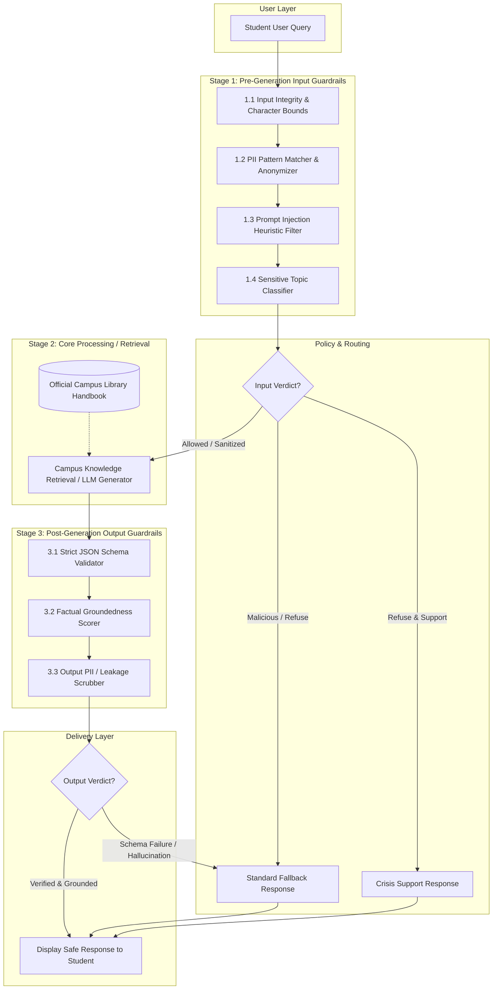

# System Architecture: Trustworthy AI Guardrails Pipeline

This document describes the architectural design, data flow, and component boundaries of the guardrail system implemented for the **Campus Library Assistant**.

---

## 1. Pipeline Diagram

---

## 2. Component Walkthrough

### Stage 1: Pre-Generation Input Guardrails
The input guardrail stage sits directly on the API perimeter. Every user request passes through sequential filters before any generation or retrieval is performed:
1. **Input Integrity & Bounds:** Validates that incoming payloads are non-empty strings and checks character length (capped at 3,000 characters) to protect against buffer overflow or token-exhaustion denial of service.
2. **PII Anonymization:** Scans the raw text for email addresses, telephone numbers, and student IDs. Identified entities are replaced with explicit replacement tokens (e.g. `[EMAIL REDACTED]`). This prevents student contact data from being recorded in LLM session memory or third-party loggers.
3. **Prompt Injection Screening:** Inspects queries for adversarial phrases attempting to override instructions (`ignore previous instructions`), extract hidden system prompts (`reveal system prompt`), or invoke jailbreaks (`DAN mode`, `developer mode`).
4. **Sensitive Topic Classifier:** Routes queries into categorized severity levels:
   - **Self-Harm:** Diverts immediately to the campus counseling hotline and national 988 lifeline.
   - **Violence:** Rejects weapon or harmful inquiries outright.
   - **Medical / Financial Advice:** Permits query processing, but appends an advisory caution banner to the resulting response.

### Stage 2: Core Processing / LLM Generator
- Receives only sanitized, validated query strings.
- Augments queries with curated reference information from the official Campus Library Handbook.
- Returns a structured dictionary candidate containing `answer`, `sources`, and `safety_note`.

### Stage 3: Post-Generation Output Guardrails
The output guardrail stage operates as an independent verification gate before UI delivery:
1. **Strict JSON Schema Validator:** Enforces exact structural conformity. Any unexpected keys, missing required fields, or invalid types (e.g. integer answer or string sources) trigger immediate rejection.
2. **Factual Groundedness Scorer:** Tokenizes the generated answer, removes high-frequency English stopwords, and calculates the lexical overlap ratio against the reference text. If the proportion of content words grounded in the reference falls below 25%, the answer is flagged as a potential hallucination and routed to a safe fallback.
3. **Output PII Scrubber:** Scans the final generated answer to ensure no confidential staff phone numbers or administrative emails were retrieved or leaked. Any remaining PII is redacted prior to display.

---

## 3. Key Design Principles

1. **Fail-Closed by Default:** Any schema failure, ungrounded claim, or fatal guardrail error triggers a safe fallback message rather than passing malformed or unverified content to the user.
2. **Zero External Dependencies:** Built purely on the Python standard library (`re`, `json`, `dataclasses`, `pathlib`) ensuring deterministic evaluation, zero latency overhead, and air-gapped testability without external API keys.
3. **Reversible Pseudonymization Readiness:** Designed so that pattern redactions can easily be adapted into keyed tokens if interactive multi-turn sessions require stateful identity recovery.
